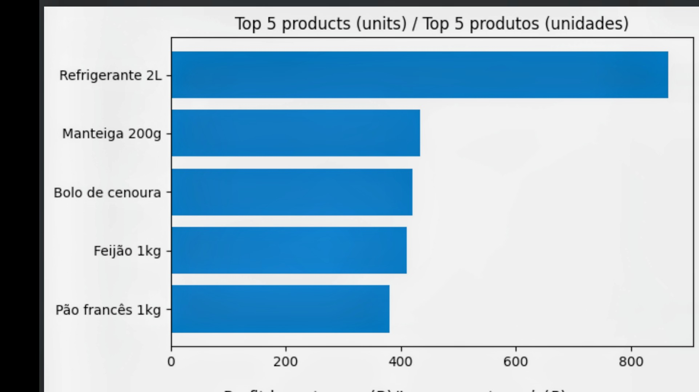
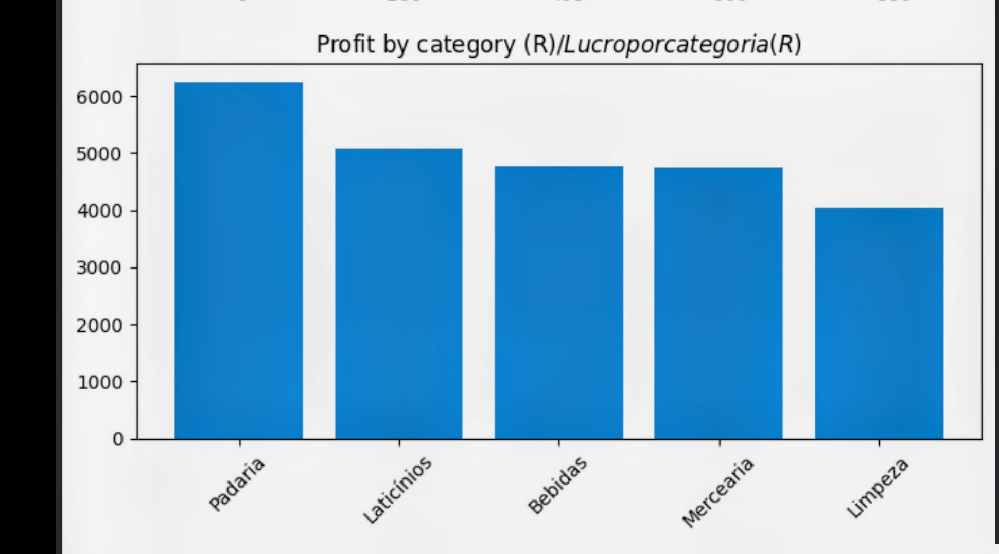
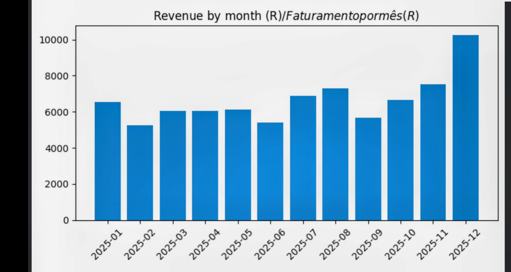
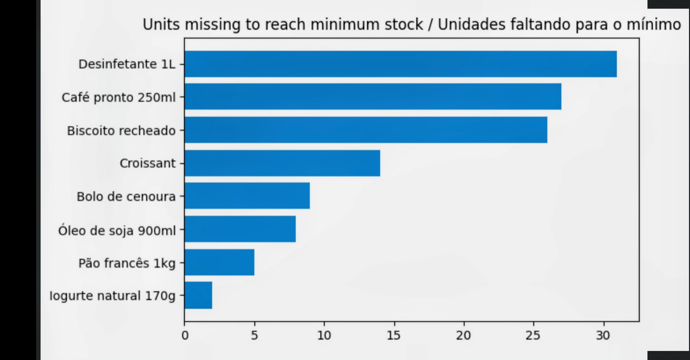
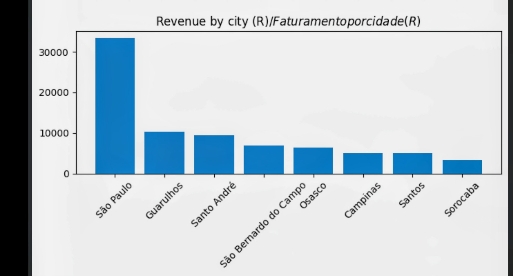

# Estoque e Vendas / Inventory and Sales

[English](#english) | [Português](#português)

---

## English

### Goal

Analyze inventory and sales of a fictional store using SQL and Pandas. All data is 100% synthetic (no real people, no personal data). The project shows entry-level data analysis: JOIN, GROUP BY, filters and charts.

### Tools

Python, Pandas, SQLite (`sqlite3`), Matplotlib, Jupyter Notebook. All free and lightweight.

### How to run

1. Open `notebook.ipynb` (Kaggle or Jupyter).
2. Run all cells in order. The first cell installs dependencies.
3. The code generates the data (fixed seed) and recreates the SQLite database from scratch on every run, so results are always the same.

### Folder structure

```
estoque-vendas/
├── notebook.ipynb     # full analysis (steps 1 to 4)
├── README.md
├── requirements.txt
├── .gitignore
├── img/               # charts used in this README
└── data/              # generated by the code (not versioned)
```

### Database (SQLite)

- `produtos`: id, nome, categoria, preço, custo
- `clientes`: id, cidade
- `vendas`: id, data, id_produto, id_cliente, quantidade
- `estoque`: id_produto, quantidade_atual, estoque_minimo

### Results

| # | Question                                | Answer                                                              |
|---|-----------------------------------------|---------------------------------------------------------------------|
| 1 | Top 5 best-selling products             | Refrigerante 2L, Manteiga 200g, Bolo de cenoura, Feijão 1kg, Pão francês 1kg |
| 2 | Most profitable category (price - cost) | **Padaria** (R$ 6,249.32)                                           |
| 3 | Products below minimum stock            | **8** products                                                      |
| 4 | Best sales month                        | **2025-12** (R$ 10,255.50)                                          |
| 5 | City that buys the most                 | **São Paulo** (R$ 33,382.30)                                        |











### What I learned

- Joining 3+ tables with `JOIN` and summarizing with `GROUP BY`.
- Calculating profit (price - cost) in SQL.
- Making the notebook reproducible: fixed seed and database recreated on each run.
- Using only synthetic data to avoid personal data (LGPD).

---

## Português

### Objetivo

Analisar estoque e vendas de uma loja fictícia usando SQL e Pandas. Todos os dados são 100% sintéticos (sem pessoas reais, sem dados pessoais). O projeto mostra análise de dados em nível de entrada: JOIN, GROUP BY, filtros e gráficos.

### Ferramentas

Python, Pandas, SQLite (`sqlite3`), Matplotlib, Jupyter Notebook. Tudo gratuito e leve.

### Como executar

1. Abra o `notebook.ipynb` (Kaggle ou Jupyter).
2. Rode todas as células em ordem. A primeira célula instala as dependências.
3. O código gera os dados (seed fixa) e recria o banco SQLite do zero a cada execução, então o resultado é sempre o mesmo.

### Estrutura de pastas

```
estoque-vendas/
├── notebook.ipynb     # análise completa (etapas 1 a 4)
├── README.md
├── requirements.txt
├── .gitignore
├── img/               # gráficos usados neste README
└── data/              # gerada pelo código (não versionada)
```

### Banco de dados (SQLite)

- `produtos`: id, nome, categoria, preço, custo
- `clientes`: id, cidade
- `vendas`: id, data, id_produto, id_cliente, quantidade
- `estoque`: id_produto, quantidade_atual, estoque_minimo

### Resultados

| # | Pergunta                                 | Resposta                                                            |
|---|------------------------------------------|---------------------------------------------------------------------|
| 1 | 5 produtos que mais vendem               | Refrigerante 2L, Manteiga 200g, Bolo de cenoura, Feijão 1kg, Pão francês 1kg |
| 2 | Categoria mais lucrativa (preço - custo) | **Padaria** (R$ 6.249,32)                                           |
| 3 | Produtos abaixo do estoque mínimo        | **8** produtos                                                      |
| 4 | Mês que mais vendeu                      | **2025-12** (R$ 10.255,50)                                          |
| 5 | Cidade que mais compra                   | **São Paulo** (R$ 33.382,30)                                        |


### Aprendizados

- Juntar 3 ou mais tabelas com `JOIN` e resumir com `GROUP BY`.
- Calcular lucro (preço - custo) direto no SQL.
- Deixar o notebook reproduzível: seed fixa e banco recriado a cada execução.
- Usar só dados sintéticos para evitar dados pessoais (LGPD).
